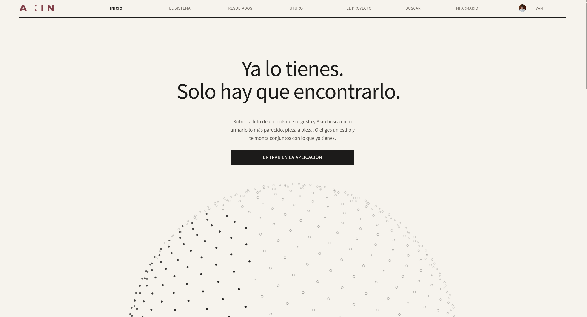
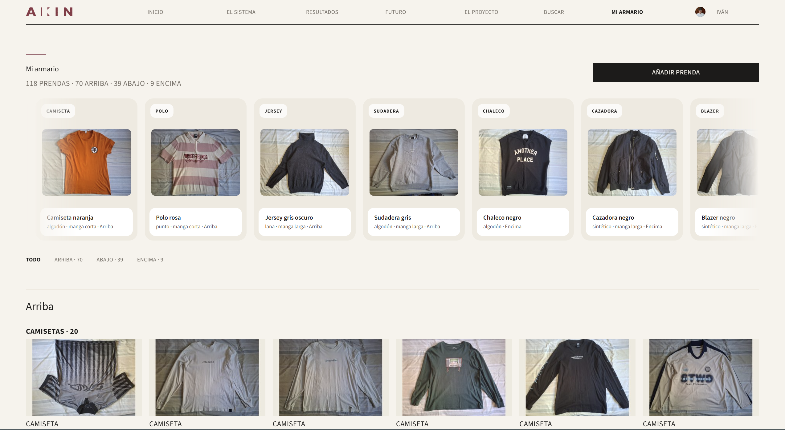
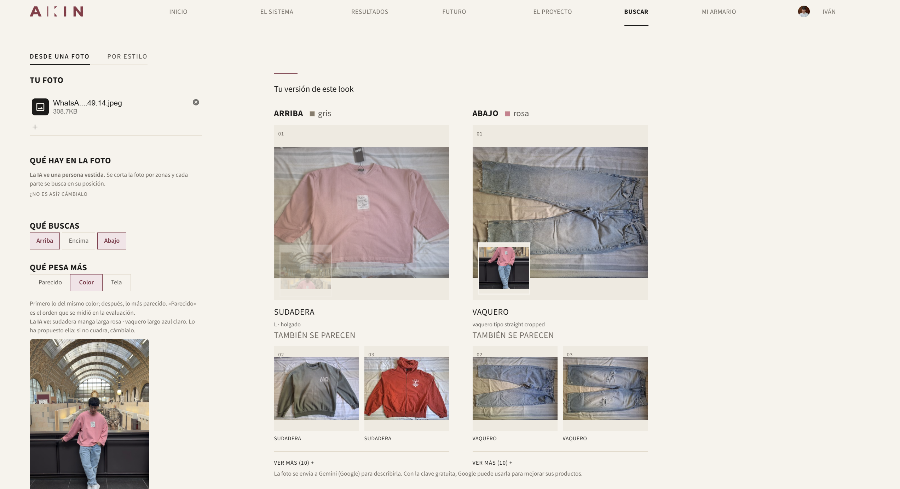
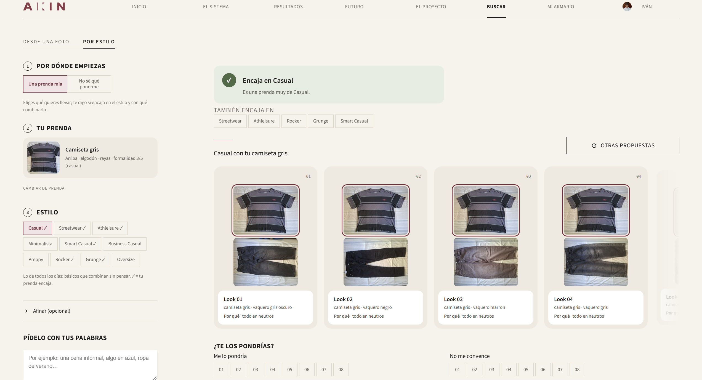
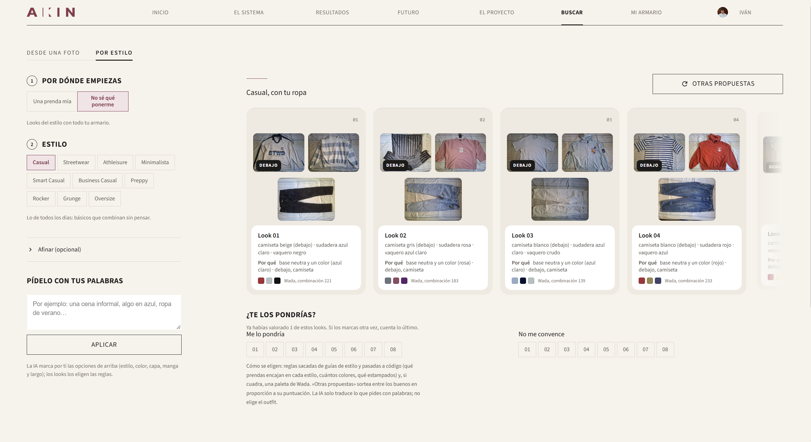
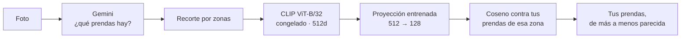

# Akin

**Le subes la foto de un look y busca en tu propio armario las prendas que más se parecen.** O le pides un estilo y te monta conjuntos con tu ropa, explicando por qué.

Trabajo de Fin de Máster · Máster en Data Science y Desarrollo de IA · Evolve Academy · 2026<br>
Autor: **Iván Delgado**



---

## El problema

Ves un look que te gusta y no sabes si tienes algo parecido en el armario. Normalmente no es que te falte ropa, es que no te acuerdas de lo que tienes. Y las apps de moda te enseñan ropa para comprar, no la que ya está en tu casa.

Akin trabaja solo con tu armario. Alcance: ropa de hombre.

## Qué hace

### 1. Mi armario

Subes fotos de tus prendas, de una en una o hasta 40 de golpe. La IA rellena tipo, color, tejido y manga, y tú corriges lo que esté mal: lo que pones tú manda. Avisa si la foto tiene una persona, no tiene ropa o la prenda ya está guardada.



### 2. Buscar desde una foto

Subes la foto de un look. La IA dice qué lleva, por capas, y la foto se corta por zonas: lo de arriba solo se compara con tus prendas de arriba, lo de abajo con las de abajo. Para cada parte sale tu prenda más parecida y dos alternativas. Puedes elegir qué pesa más (forma, color o tela) o pedirlo con tus palabras: «de manga larga».



### 3. Por estilo, con una prenda tuya

Eliges una prenda y uno de 10 estilos. Te dice si encaja y por qué, en qué otros estilos sí pega, y monta looks con tu ropa. Cada look explica por qué sale y se puede valorar.



### 4. Por estilo, sin saber qué ponerte

Eliges solo el estilo y monta el look entero. Si lleva sudadera o jersey, añade la camiseta que va debajo.



## Cómo funciona



- **CLIP** convierte cada foto en un vector de 512 números. No lo he reentrenado.
- **La proyección** es una capa lineal de 512 a 128 dimensiones, entrenada con pérdida contrastiva sobre las etiquetas de atributos de DeepFashion (109.012 imágenes de entrenamiento). Junta las prendas que se parecen como prenda.
- **Gemini** describe las fotos y traduce lo que escribes a filtros, siempre con listas cerradas. **No elige qué prenda sale ni en qué orden**: eso lo deciden los vectores y unas reglas. Así, con el mismo armario, sale siempre lo mismo.
- **Por estilo** usa reglas sacadas de guías de estilo y códigos de vestimenta (formalidad del 1 al 5, capas, cuántos colores) y las 348 paletas del *Diccionario de combinaciones de colores* de Sanzo Wada (1933).

## Resultados

Todo comparado contra CLIP sin tocar, con intervalos de confianza al 95 % por bootstrap pareado. Detalle en [`docs/`](docs/) y configuración de cada corrida en [`experiments/`](experiments/).

**1. La proyección busca mejor que CLIP, también con atributos que no vio al entrenar.**

| NDCG@10 (validación, 12.211 consultas) | Atributos vistos | Atributos no vistos |
|---|---|---|
| Aleatorio | 0,0118 | 0,0112 |
| CLIP | 0,1010 | 0,1141 |
| CLIP + PCA a 128d (control) | 0,1028 | 0,1133 |
| **Proyección conjunta** | **0,1226** | **0,1273** |
| Proyecciones por atributo | 0,1223 | 0,1206 |

**2. La hipótesis principal no se sostuvo.** La idea era una proyección por atributo (corte, textura, tejido), para poder pedir «parécete en el corte, ignora el color». Con el mismo número de datos, mejoran un poco con los atributos que vieron al entrenar (+0,0035) y no se distinguen del ruido con los nuevos (−0,0058). Se especializan en las etiquetas, no aprenden la idea de «corte». Lo comprobé con cinco controles: aleatorio, PCA, mismo presupuesto de datos, MLP y atributos escondidos. La app usa la proyección única.

**3. Fotos de tienda frente a fotos de móvil.** Fotografié mis 118 prendas con el móvil (236 fotos), solo para probar, nunca para entrenar. Un clasificador lineal distingue una foto de catálogo de una de móvil sin fallar (AUC 1,000). Aun así, buscando no se detecta una caída con esta muestra.

**4. En la app.** Desde la foto de un modelo, la prenda exacta sale **la primera en 22 de 30 casos** entre 172 prendas (CLIP: 19) y entre las tres primeras en 27 de 30 (CLIP: 23). Son fotos nuevas, recogidas después de escribir cómo se iba a medir.

**5. Gemini, medido.** Contra mis anotaciones a mano: tipo de prenda 105/118, manga 25/27. Por eso solo se usan como filtro los campos estables.

## Lo que no hace

- **Los looks no están validados con usuarios.** Salen de reglas; las valoraciones se guardan para poder medirlo, pero de momento solo hay las mías.
- **No te dice si algo te favorece.** No hay datos públicos para eso, y un modelo así aprendería sesgos sobre cuerpos.
- **La IA se equivoca a veces con el tipo de prenda.** Todo lo que rellena se puede corregir.
- **Es un prototipo local.** No está desplegado.

## Siguientes pasos

- PostgreSQL con pgvector, para muchos usuarios y un catálogo grande.
- Un catálogo de tiendas: si no tienes nada parecido, enseñarte dónde comprarlo.
- Medir con valoraciones reales qué reglas aciertan y, más adelante, cambiarlas por un modelo de compatibilidad.

## Stack

Python 3.11 · PyTorch 2.11 (CUDA 12.8) · Hugging Face Transformers (CLIP ViT-B/32) · scikit-learn · pandas · NumPy · PyArrow · Gemini API (salida estructurada) · Streamlit · SQLite

## Ejecutarlo

```
python -m venv .venv
.venv\Scripts\activate
pip install torch torchvision --index-url https://download.pytorch.org/whl/cu128
pip install -r requirements.txt
streamlit run app.py
```

Gemini necesita `GEMINI_API_KEY` en un fichero `.env`. Sin clave, la app funciona igual y te pregunta en vez de proponer.

Para reproducir el entrenamiento hace falta descargar DeepFashion (ver [`data/README.md`](data/README.md)); los pasos están en [`docs/resultados_modelado.md`](docs/resultados_modelado.md).

## Estructura

```
app.py, paginas/      la aplicación
src/                  datos, entrenamiento y evaluación
experiments/          una carpeta por corrida: config.yaml y métricas
docs/                 protocolos y resultados
docs/entregas/        las cinco entregas del máster
tests/                pruebas
data/                 fuera de git
```

## Datos

| Fuente | Uso | Licencia |
|---|---|---|
| [DeepFashion](https://mmlab.ie.cuhk.edu.hk/projects/DeepFashion.html) | Entrenamiento y evaluación | Solo investigación académica. Las imágenes no están en este repo |
| Armario propio · 118 prendas | Test con fotos de móvil | Fotos del autor, no incluidas |
| Parejas modelo / producto · 54 | Evaluación de la búsqueda | Fotos de tienda, solo en local |
| [Diccionario de Wada](https://github.com/mattdesl/dictionary-of-colour-combinations) | Paletas de «Por estilo» | MIT |

DeepFashion resultó ser mayoritariamente ropa de mujer, incluso filtrando por categorías (está medido en [`docs/resultados_anotacion_dominio.md`](docs/resultados_anotacion_dominio.md)). El producto es de hombre; el corpus de entrenamiento, no.

## Contexto académico

El proyecto se fue construyendo en cinco entregas a lo largo del máster, todas en [`docs/entregas/`](docs/entregas/): ideación, selección de idea y datos, modelo de datos, estrategia de modelado y diseño del frontal. La defensa fue el 30 de septiembre de 2026, enseñando la app en directo.

Semillas fijadas (42), un `config.yaml` por corrida y el conjunto de test evaluado una sola vez, al final.
